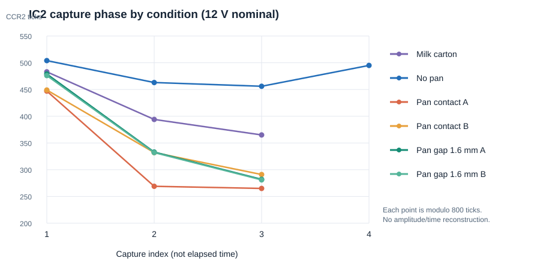
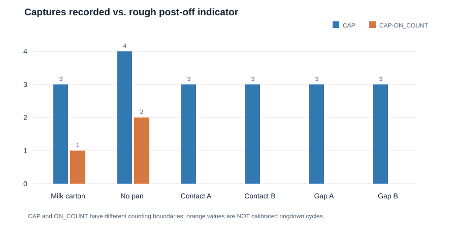
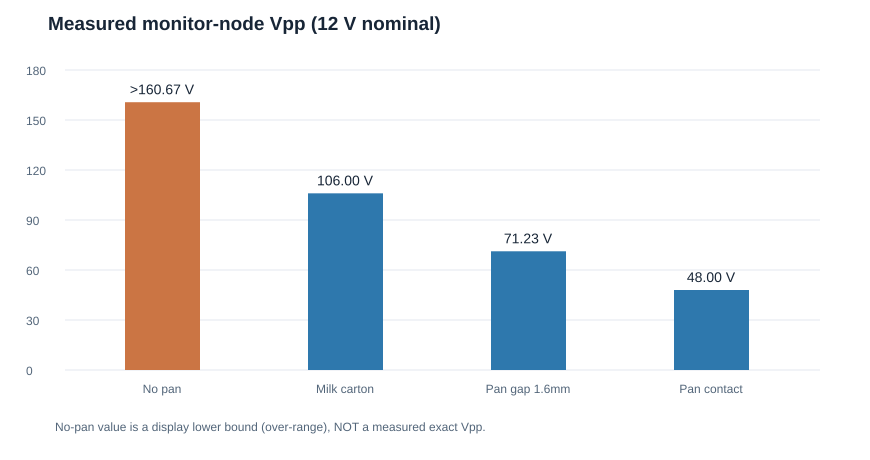

# IH01A 双周期脉冲检锅研究报告：波形、IC2 捕获及可迁移结论

> 日期：2026-11-10  
> 性质：试验性技术研究记录；**不是已验收的检锅算法、整机安全认证或继续开发计划**。  
> 固件核对基线：仓库 main 分支提交 [75002b0](https://github.com/TKWTL/IH01A-Compact_Induction_Heater/commit/75002b0406d8df573f792b0500cf638038a41d01)。  
> 实测来源：2026-11-10 用户提供的 6 条串口 [PAN] 记录和 4 幅 SIGLENT 示波器截图；截图原图已存于仓库 `Images/Testing/`，下文直接引用；曲线和柱状图由本报告所列原始数字生成。  
> 研究范围：**仅检锅**（短脉冲激励、自由振荡、捕获、判别及安全约束）。不涉及 MiaoUI 中文化、通用 GUI、PD/EPR 研发总结或其他功能的收尾报告。

## 1. 摘要与结论等级

IH01A 已实现以 TIM1 短时开通功率级、再断开并采集 CT_ZERO/IC2 上升沿的试验性检锅流程。本次实验使用**标称 12 V 供电**，检锅激励为 **160 kHz、180° 相移、2 个 PWM 周期**。六次捕获记录显示，在同一采集逻辑下，**无锅时断电后仍有 2 次捕获**，贴合或间隔约 1.6 mm 的锅具测试中均未记录到断电后的捕获；利乐牛奶包装条件下有 1 次。这是潜在的“电磁耦合/阻尼差异”信号，但既不证明有可靠的锅具分类器，也不证明该短脉冲已经安全。

| 结论 | 证据强度 | 边界 |
|---|---|---|
| 两周期激励能产生不同负载条件下可分辨的波形与 IC2 记录 | **已观察** | 仅本批样机、固定频率、少量测试 |
| 有锅条件下观察到断电后捕获更少 | **已观察** | 捕获计数与关断时刻存在同步/统计口径问题 |
| 锅具改变谐振频率及回路损耗 | **物理上合理的解释** | 本批数据未分离频率、阻尼及比较器门限效应 |
| 仅凭 CAP、ON_COUNT、RAW 可可靠识别锅具/异物 | **未证实** | 缺少绝对边沿时间戳、幅度与足够样本 |
| 当前 160 kHz 双周期激励足以保证开关器件安全 | **未证实** | 既往发生 TIM1 Break；无锅谐振节点测得超量程波形 |

**研究处置意见：** 保存激励—关断—观察的思路与原始数据；不固化识别阈值、不宣称已完成检锅。后续实用功率等级的电磁炉应重新验证激励安全性、信号链和识别性能。

## 2. 试验硬件与现有软件实现

### 2.1 电气与定时条件

| 参数 | 本次条件 / 代码配置 | 依据或说明 |
|---|---|---|
| MCU | STM32G071，Cortex-M0+ | IH01A 固件 |
| TIM1 输入时钟 | 128 MHz，PSC=0 | [conv_phase.h](../../Firmware/APP/PowerControl/conv_phase.h)、[tim.c](../../Firmware/Core/Src/tim.c) |
| 脉冲频率 | 160 kHz | [pan_probe_config.h](../../Firmware/APP/PowerControl/pan_probe_config.h) |
| TIM1 ARR | 799 | 128 MHz / (799+1) = 160 kHz |
| 激励相移 | 180° | PAN_PHASE |
| 计划激励长度 | 2 个 PWM 周期，名义上 12.5 μs | PAN_CYCLES；**不代表实测 PC6 导通时间** |
| 脉冲间隔 | 2 s | PAN_PERIOD_MS=2000 |
| 断电后收集等待 | 4 ms | PAN_CAPTURE_MS=4 |
| 布防超时 | 10 ms | PAN_TIMEOUT_MS=10；仅特定状态使用 |
| IC2 DMA 缓冲 | 48 个 uint16_t | PAN_DMA_LEN=48 |
| 边沿输入 | PA9 / TIM1_CH2，直接 TI2，上升沿，输入滤波 0 | [tim.c](../../Firmware/Core/Src/tim.c) |
| 功率级使能 | PC6 -> FD2204 EN | 由 TIM1 更新中断脉冲控制；保护触发拉低 |
| 试验供电 | **标称 12 V**（用户确认的本次测试条件） | 串口记录未逐条列出实测 VBUS；不能据此证明每次脉冲的电压瞬态完全相同 |

时间基准：

\[
T_{\mathrm{tick}}=\frac{1}{128\times10^6}=7.8125\ \mathrm{ns}
\]

\[
T_{\mathrm{PWM}}=(799+1)T_{\mathrm{tick}}=6.25\ \mathrm{\mu s},\qquad
T_{\mathrm{pulse,nominal}}=2T_{\mathrm{PWM}}=12.5\ \mathrm{\mu s}
\]

该长度是按 TIM1 更新事件计算的设计值。因 PC6 由中断服务程序控制，实际边沿还包括中断进入、指令执行、驱动器使能/关闭延迟，以及可能由硬件 Break 引起的提前终止。

### 2.2 状态机与数据路径

当前实现见 [conv_controller.c](../../Firmware/APP/PowerControl/conv_controller.c)：

1. 只有用户使能检锅、显式 RUN 已确认、预约关断时间非零且仍剩余时间，并满足既有 PD/ADC/温度/COMP/Break 互锁时，才运行检锅序列。
2. 前台保存原 ARR/相移，将下一周期的预装载寄存器设置为 160 kHz / 180°，清理采样缓存并启动 TIM1_CH2 DMA。
3. 首次 TIM1 更新中断切换到检锅状态并拉高 PC6；后续更新中断按 2 个周期计数，结束时拉低 PC6。**TIM1 继续计数**，IC2 DMA 继续记录上升沿。
4. 前台达到收集条件（DMA 满，或 PC6 关闭后约 4 ms）时停用捕获 DMA、格式化 [PAN] 日志，恢复原 ARR/相移。
5. 硬件 TIM1 Break 或已锁存故障可中止流程。**不允许因检锅失败而屏蔽保护。**

图示：

    手动 RUN + 互锁检查
             │
             ▼
       保存原频率/相移
             │
             ▼
       DMA 布防 + 预装载
             │
             ▼
      TIM1 更新 → PC6 ON
             │
       2 个 PWM 周期
             │
             ▼
      TIM1 更新 → PC6 OFF
             │
       CH2 继续捕获
             │
             ▼
       停 DMA / 输出记录
             │
             ▼
       恢复原 PWM 配置

代码将该流程分为 PAN_IDLE、PAN_ARMED、PAN_ACTIVE、PAN_COLLECT、PAN_ABORTED 五个状态。当前自动追频并不构成检锅的一部分；检锅执行前要求自动追频关闭。

### 2.3 串口字段的精确定义

记录示例：

    [PAN] SEQ=131 FREQ=160K PHASE=180 CYC=2 CAP=4 ON_COUNT=2 RAW=504,463,456,495

- **SEQ**：已布防的尝试序号；包含可能未输出记录的尝试。
- **FREQ / PHASE / CYC**：配置值，并非示波器实测频率或导通时间。
- **RAW**：按顺序记录的 TIM1->CCR2 **16 位计数值**，范围为 0～ARR；每个数是输入边沿发生时该 PWM 周期内的计数相位，**不是 CT 电压幅值，也不是相邻两边沿间隔**。
- **CAP**：当前程序筛选后、有效 CCR2 不超过 ARR 的 DMA 项数量。
- **ON_COUNT**：从 PC6 置高前的 DMA 起始索引，到 PC6 拉低时的 DMA 写入索引之差；它按照 **原始 DMA 传输数量** 统计，不是“已经证明完整位于导通期间的真实槽路振荡周期数”。

注意：当前程序只有在至少发现一条有效捕获时才打印 [PAN] 数据。**无任何有效捕获的尝试可能不会出现在串口日志中**，因而仅使用可见日志评估检出率会产生选择偏差。

## 3. 原始数据与可复算统计

### 3.1 六组串口实测

以下 RAW 均按用户原样转录，不做滤波或补齐：

| 条件 | SEQ | CAP | ON_COUNT | RAW | CAP−ON_COUNT |
|---|---:|---:|---:|---|---:|
| 利乐牛奶包装贴合 | 130 | 3 | 2 | 483,394,365 | 1 |
| 无锅 | 131 | 4 | 2 | 504,463,456,495 | 2 |
| 锅具贴合① | 132 | 3 | 3 | 447,269,265 | 0 |
| 锅具贴合② | 133 | 3 | 3 | 449,332,291 | 0 |
| 锅具离线圈约 1.6 mm① | 134 | 3 | 3 | 479,333,282 | 0 |
| 锅具离线圈约 1.6 mm② | 135 | 3 | 3 | 476,332,281 | 0 |

**CAP−ON_COUNT 是便于观察的粗略分段指标，而非已校验的关断后真实振荡次数。** 原因是 CAP 为筛选后的有效值计数，ON_COUNT 来自另一套 DMA 位置计数；中断时间与采样交接处存在分界误差。若 DMA 缺失捕获、噪声误触发或筛选丢弃了条目，该差值会进一步失真。

对 RAW 的另一种描述性统计，是第一、第二捕获相位的计数差：

| 条件 | RAW1−RAW2（tick） |
|---|---:|
| 利乐牛奶 | 89 |
| 无锅 | 41 |
| 锅具贴合① | 178 |
| 锅具贴合② | 117 |
| 1.6 mm① | 146 |
| 1.6 mm② | 144 |

该差异提示“相邻捕获边沿在 TIM1 周期坐标中的相位位置不同”，但**无法仅凭两个模 800 的计数值推断真实自由振荡频率**。例如，若额外假设无漏边沿且恰好相隔一个 TIM1 溢出，则无锅首两次捕获间隔是：

\[
\Delta N=(800-504)+463=759\ \mathrm{ticks}
\]

\[
\Delta t=\frac{759}{128\times10^6}\ \mathrm{s}
\approx5.930\ \mathrm{\mu s},\quad
f_{\mathrm{example}}\approx168.64\ \mathrm{kHz}
\]

这个 **168.64 kHz 只是“一次溢出、连续同类上升沿”假设下的示例计算，不是已实测的无锅自然频率**。若发生漏边沿、多次溢出或比较器过驱导致触发时刻改变，结论即不成立。同理，也不应将锅具组的 RAW1−RAW2 直接解释为载锅谐振频率。

### 3.1.1 捕获序列折线图

**图 1：** 六次检锅的 TIM1_CH2 / CCR2 模周期计数位置。横轴是**第几次捕获**，不是物理时间；纵轴是 0～799 范围的定时器计数。折线只辅助观察各组捕获位置的差异，**不能解释为电流包络或真实时域连续曲线**。

**图 2：** 蓝柱为记录中的 CAP，橙柱为 CAP−ON_COUNT 的近似指标。橙柱反映既有统计口径下的粗略分段，不应视作经过校准的断电后振荡周期数。图中无锅 2、利乐包装 1、载锅 0 的顺序来自**本组六条**数据，不能用于推定误判率。

### 3.2 四幅示波器截图摘要

截图显示的是既往所述“半桥—L—监测点—C—半桥”测点的脉冲/余振波形；**不是经过确认的电容两端差分电压，也不是 CT_OUT 电流测量**。所有截图显示时间基准约 5 μs/div，CH1 20 V/div、10X 探头设置。由截图屏幕的自动测量栏读取：

| 截图条件 | 屏幕显示的 CH1 峰峰值 | 主要现象和局限 |
|---|---:|---|
| 1.6 mm 间距有锅 | 71.23 V | 可见约两个主要振荡起伏后快速衰减 |
| 利乐包装贴合 | 106.00 V | 有明显尖峰及短促振荡，不能据此认定它是可加热锅具 |
| 锅具贴合 | 48.00 V | 本组振幅较低，后续余振很短 |
| 无锅 | >160.67 V（屏幕超量程） | 峰值超出屏幕/测量可靠范围，真实峰峰值只能视为更高的可能值，不能当作精确读数 |

**截图与日志不是一一标定同步采集的记录**：截图未含 SEQ、PC6 通道及完整母线电压时间戳，因此不能把某一幅波形的绝对振幅与某条 RAW 数据做逐周期配对。触发、探头接地方式、带宽限制、屏幕裁剪和超量程也会影响比较。部分截图屏幕顶部显示频率约 151.26 kHz；该自动频率读数出自短时非稳态波形，不能直接作为检锅激励频率或自然振荡频率。

**观测上**，无锅节点的瞬态电压可能显著高于贴合锅具状态；但此电压是指定单端测点的响应，不可推出谐振电容实际耐压裕量、MOSFET 的 VDS 应力或 ZVS 状态。特别是无锅截图超量程时，无法从读数求真实最大幅值。

### 3.2.1 四种条件下的原始示波器截图

以下为仓库已保存的 **SIGLENT 原始截图**，不作波形重绘；注意截图包含示波器自动读数和可能的超量程提示。

| 无锅 | 利乐牛奶包装贴合 |
|:---:|:---:|
|  |  |
| **锅具贴合** | **锅具离线圈 1.6 mm** |
|  |  |

**图 3：** 四种耦合条件下的瞬态波形，测点为原实验所述半桥—L—监测点—C—半桥之间的监测点；并非线圈电流或谐振电容差分电压。截图与具体 SEQ 未做统一触发同步。

**图 4：** 从四张截图读取的 CH1 峰峰值。**无锅为 >160.67 V，已超出可靠显示范围**，图中该柱仅绘出读数所示的下界而非精确峰峰值；不据此计算实际过压倍数或器件裕量。

## 4. 物理模型与可观察量

### 4.1 两种耦合效应不能混同

把线圈与负载的瞬态行为简化为串联 RLC 等效回路。在释放激励、近似线性、参数短时间不变且处于欠阻尼状态时：

\[
i(t)=A e^{-\alpha t}\sin(\omega_d t+\phi),\qquad
\alpha=\frac{R_{\mathrm{eff}}}{2L_{\mathrm{eff}}}
\]

\[
\omega_d=\sqrt{\frac{1}{L_{\mathrm{eff}}C_{\mathrm{eff}}}-\alpha^2},
\qquad f_d=\frac{\omega_d}{2\pi}
\]

其中 A 为初始幅度、\(\phi\) 为初始相位，\(R_{\mathrm{eff}}\)、\(L_{\mathrm{eff}}\)、\(C_{\mathrm{eff}}\) 是等效参数。**这些等式是近似模型，不是对实际全桥、非线性磁性材料、驱动续流路径及复杂寄生参数的精确表述。**

锅具靠近时至少可能同时改变：

1. **等效损耗**：涡流、磁滞等损耗使振荡包络可能更快衰减；比较器边沿可能更早消失。
2. **等效电感/谐振频率**：金属、磁性和几何间距改变线圈负载，导致电流与 PWM 的相位以及自由振荡周期变化。
3. **起振初始条件**：同样是两个 PWM 周期，离共振点的距离、负载与实际 PC6 开关时序会改变关断时的储能。

因此不能将“关断后 IC2 边沿少”单独解释为阻尼增大，也不能将“RAW 相位差大”单独解释为谐振频率变化。比较器的迟滞、固定阈值、带宽和 CT 增益会叠加影响。

### 4.2 当前观测量对应的物理信息

| 观测手段 | 能观察什么 | 目前不能可靠回答什么 |
|---|---|---|
| IC2 模周期 CCR2 | 捕获到的特定极性比较器边沿在 PWM 周期内的位置 | 真实边沿绝对时间、遗漏了多少周期、实际振荡幅值 |
| CAP 与 ON_COUNT | 记录链路是否得到边沿及一个粗略分段 | 准确的余振衰减时间、品质因数 Q |
| 示波器单端测点 | 瞬态节点电压、尖峰和可见振荡形态 | 真实线圈电流、谐振电容电压、可靠的开关损耗 |
| 20 kHz 的 TIM6/ADC 常规扫描 | 低频监控量、母线/温度/保护状态 | 对 160 kHz 振荡波形进行无混叠重建；50 μs 采样间隔也太粗，难以分辨十几微秒的激励 |

尤其不能把 [ZCD_PHASE_COMPENSATION.md](ZCD_PHASE_COMPENSATION.md) 中基于旧 CT_OUT 0.100 V/A 的相位延迟拟合，直接复用于现有标称 0.075 V/A 传感链路。比较器翻转延迟受波形斜率与过驱影响，该旧拟合本来也是空载条件下的经验模型。

### 4.3 利乐包装的意义

此样本可能涉及包装内部的薄金属阻隔层，但未核验该包装实际材料结构；也可能同时受到放置姿态、介电/导电耦合和阈值误触发影响。它不等价于空载，也不等价于合格加热锅具。

本批记录中“无锅 2、包装 1、锅具 0”的顺序值得进一步研究，但**只有 1 组包装和 1 组无锅记录**，不能据此宣称对异物具有可靠区分能力。未来算法需要至少区分：无明显耦合、存在耦合但不适合加热、允许加热的合格锅具。

## 5. 当前实现的关键测量缺口

按对后续检锅研究的影响排序：

1. **无绝对时间戳。** DMA 仅存每次 TIM1 CCR2 的模周期数值，不保存溢出次数。实际边沿间隔 \(\Delta t=(n\cdot800+CCR2_b-CCR2_a)/128\,\mathrm{MHz}\)，其中整数 n 未记录；还无法证明每次中间没有漏边沿。
2. **关断时间界面不精确。** ON_COUNT 是 ISR 中读取的 DMA 计数，不附带相同时间基准下的 PC6 实际引脚翻转时间；CAP 是后验筛选的有效数据总数。数据有轻微时序错配即可导致 ON/OFF 分类变化。
3. **采集窗口与真实余振尺度不匹配。** 4 ms 收集窗口远大于十几微秒脉冲与截图中的短暂余振。窗口尾部的噪声边沿、其他干扰也可能计入 CAP。
4. **只有单一边沿阈值。** 比较器边沿消失可能是振幅低于阈值，也可能是模拟信号链的过驱/恢复特性变化；没有直接测得余振包络。
5. **零边沿尝试未完整落日志。** 仅在有有效 DMA 数据时打印 [PAN]，丢失“0 捕获”事件会使离线统计偏倚。
6. **PC6 脉冲宽度尚未独立计量。** TIM1 UPDATE ISR 负责拉高/拉低 PC6，名义 12.5 μs 不自动等于实际导通时长；异常时仅有 ADC 帧计数后备关断，不能视为微秒级硬件脉宽保证。
7. **缺少可直接关联的多通道示波器记录。** 需要同一时间轴对齐 PC6、桥臂波形、CT_ZERO、槽路电流和目标监测点，且采用适当探头，才能将捕获序列与物理响应定量联系。

这里的缺口是**研究数据质量与测量方法**问题，不应通过临时放宽过流保护或盲目加长导通时间解决。

## 6. 安全性：此次波形比分类阈值更重要

既往 150 kHz、6 周期实验出现过 **0x00004000 = TIM1 硬件 Break**。当前固件将激励改为 160 kHz、2 周期，其目标是减少注入能量；**减小脉冲周期数并不能证明任何器件已经处于安全工作区**。

无锅条件下监测点的示波器测量已出现 **>160.67 V 的超量程瞬态**。在电感与电容的谐振系统中，本次标称 12 V 的较低直流母线电压仍可能产生很高的交流节点电压或电流。不能以“约 12 V 供电”替代器件电压/电流应力测量。

对后续实用电磁炉，必须坚持：

- 保留独立硬件过流比较器、TIM1 Break 和驱动器关断；检锅判断不构成解除保护的权限。
- 在确定激励频率和脉冲长度前，先用有余量的测量方案验证 **VDS、实际谐振电容差分电压、槽路峰值电流及 PC6 实际高电平持续时间**；避免错误的示波器接地造成短路。
- 明确 **无锅最不利电压/电流条件**，而不是只在载锅状态验证。对硬件保护的意外触发应保留故障并人工检查，不自动重试。
- 160 kHz 接近先前约 158 kHz 的空载振荡频率；它可以增强空载响应，也可能放大无锅时的电应力。实际负载可能使谐振频率明显变化，不能以单一固定频率推断全工况 ZVS。
- 在安全性未经过实机验证之前，不移植当前参数到更高母线电压或更大功率等级。

## 7. 面向后续电磁炉的检锅研究路线（不在 IH01A 继续编码）

### 阶段 A：将脉冲与测量时间统一

统一时间基准记录：实际 PC6 上升/下降沿、激励频率与周期数、每个 IC2 上升沿的绝对时间或溢出扩展计数、是否有 DMA 溢出/丢失捕获、故障类型、VBUS 实测值。无捕获也须输出一条完整记录。先用逻辑分析仪或示波器确认双周期激励没有在故障、调度拥塞或 DMA 结束时被意外延长。

### 阶段 B：建立不依赖单阈值的特征

优先研究三个彼此互补的量：

1. **关断后衰减速度**：以可量化的模拟包络（高速采样或专用包络/峰值检测）估计衰减率；不要把“停止过零”当作精确衰减幅值。
2. **自由振荡周期变化**：使用带溢出计数的连续捕获，明确是连续边沿且无漏采后才估计 \(f_d\)；区分激励期锁频响应与关断后的自由振荡。
3. **重复性与一致性**：固定几何条件下多次试验的特征离散度，以及改变锅具间距、材质、位置后特征是否稳定可分。

可将空载基准特征与当前试验差异作比较，但自适应阈值必须考虑温度、供电与元件公差造成的变化。

### 阶段 C：实验矩阵与验证统计

至少覆盖无锅、有效锅具贴合、不同空气间隙（包括 1.6 mm）、偏心放置、不适合加热的金属薄片/包装、多种锅具材质及口径，并在**已经验证安全**的激励条件下测试不同供电、器件温度与重复装配偏差。所有实验需要完整的原始记录，而不只保留成功捕获的记录。

先独立划分开发数据与盲测数据，再报告：合格锅具检出率、异物误接受率、无锅误接受率、未决率和响应时间。六条样本不能计算可推广的性能。若将某类误接受概率目标设为 **低于 1% 且要求单侧 95% 置信上界**，独立同分布伯努利试验中即使 300 次无误判也只是接近该证据量级；不能用几次“均成功”替代统计验证。

### 阶段 D：工程判别逻辑

建议未来采用“**候选耦合 → 可靠性确认 → 合格锅具确认 → 允许主加热**”的多阶段状态机。模糊或阈值边界条件应拒绝自动加热，而不是把任何可感测金属都判定为锅具。检锅信号链、开关脉冲控制与安全硬件关断仍应保持职责分离。

## 8. 可迁移 / 不可直接迁移的成果

| 建议保留 | 不应直接复制到实用等级产品 |
|---|---|
| 短脉冲后关断、独立观察自由响应的基本思路 | 160 kHz / 180° / 2 周期作为通用安全检锅参数 |
| TIM1 预装载更新 ARR/CCR、保护优先的状态机结构 | 直接用 ISR 软定时脉宽作为独立安全保证 |
| TIM1_CH2 上升沿捕获 + DMA 的低 CPU 占用结构 | 仅记录模周期 CCR2 就估算绝对频率/衰减时间 |
| 将无锅、锅具和非合格物体作为不同实验类别 | 根据本组六条记录固化分类阈值或宣称检出率 |
| 原始波形与故障日志保留、离线验证的工作方式 | 将旧版 CT_ZERO 相位补偿直接用于新 CT 前端 |

相关源码入口：

- 检锅参数：[Firmware/APP/PowerControl/pan_probe_config.h](../../Firmware/APP/PowerControl/pan_probe_config.h)
- 激励状态机、更新中断、DMA 与串口输出：[Firmware/APP/PowerControl/conv_controller.c](../../Firmware/APP/PowerControl/conv_controller.c)
- TIM1 捕获通道配置：[Firmware/Core/Src/tim.c](../../Firmware/Core/Src/tim.c)
- 相移和 ARR 映射：[Firmware/APP/PowerControl/conv_phase.c](../../Firmware/APP/PowerControl/conv_phase.c)
- CT_ZERO 相位计算：[Firmware/APP/PowerControl/conv_zcd.c](../../Firmware/APP/PowerControl/conv_zcd.c)
- 脉冲配置主机测试：[Firmware/Tests/host/test_pan_probe_config.c](../../Firmware/Tests/host/test_pan_probe_config.c)
- 既往背景：[Docs/LOW_POWER_ZCD_BENCH.md](LOW_POWER_ZCD_BENCH.md)、[Docs/ZCD_PHASE_COMPENSATION.md](ZCD_PHASE_COMPENSATION.md)

## 9. 研究结语

这轮试验最大的价值不是得到一个立即可用的“有锅/无锅”阈值，而是确认：**同一短脉冲激励下，外界耦合状态可以在瞬态波形与捕获边沿序列中留下可观察的差异**；同时也暴露了模周期时间戳、比较器阈值、脉冲真实宽度、硬件过压应力和样本统计不足的问题。

因此，IH01A 检锅工作的合理归档状态是：**原理可观察；判别未验证；安全参数未验收；可供后续独立设计参考，不可作为可直接投入实用功率电磁炉的现成模块。**
