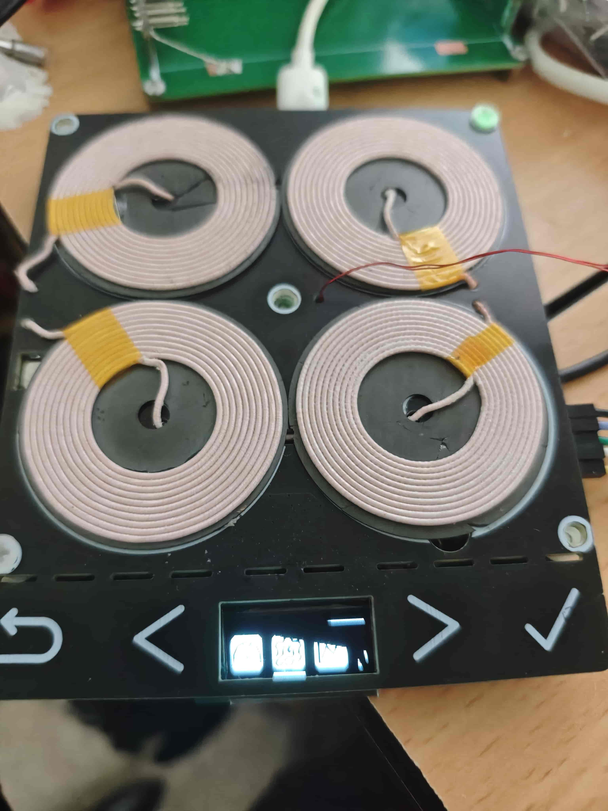
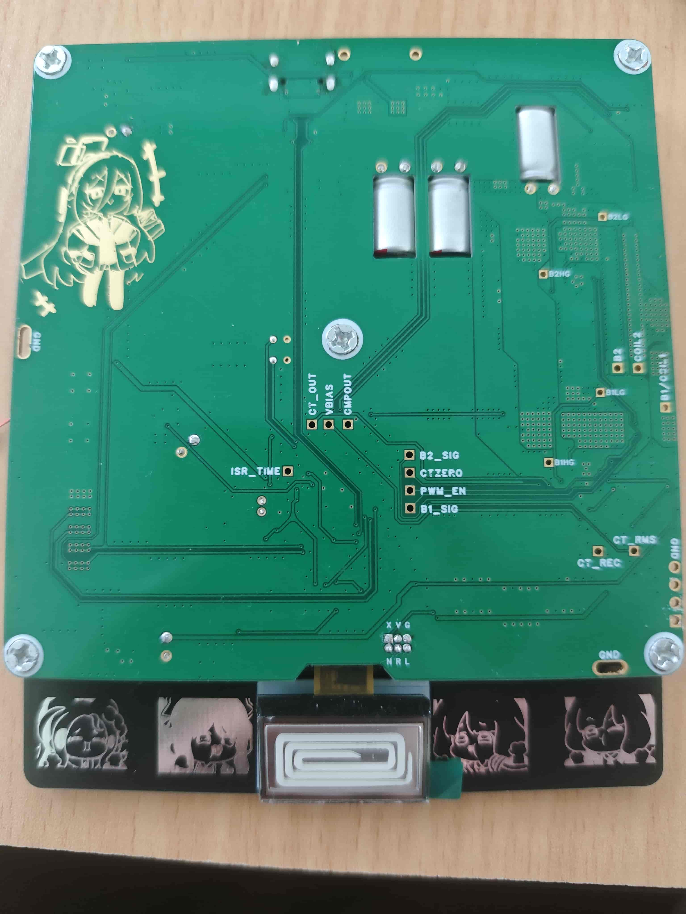
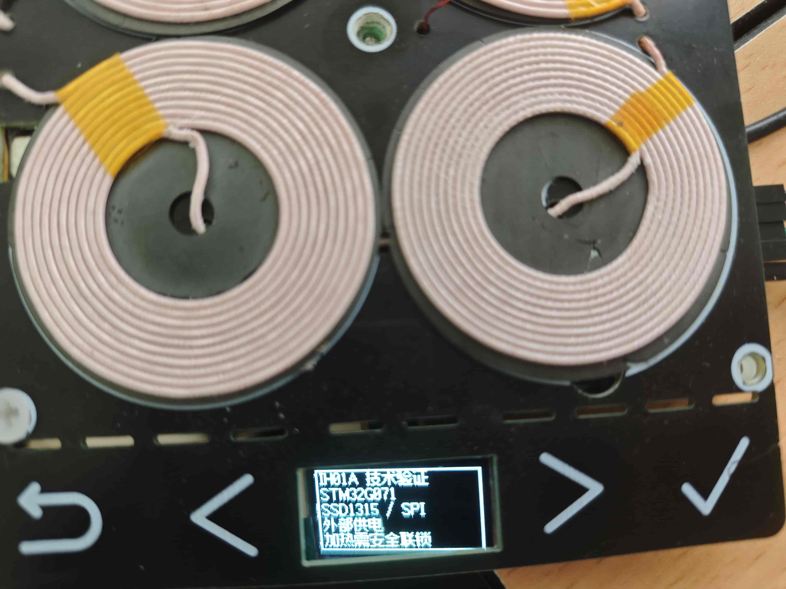

# IH01A · Compact Induction Heater

> **项目状态：实验性原型 / 技术储备（未达到实用加热目标）**
>
> IH01A 是一款基于 STM32G071 的小型感应加热器实验平台，围绕 USB-PD EPR 供电、移相全桥、谐振电流测量、零电流捕获和短脉冲检锅开展验证。**实际加热功率偏低，尚不能满足原定使用目标；未完成连续有效热功率、效率、温升和完整安全验收，不作为可用电磁炉或成品发布。**

| PCB 正面 | PCB 背面 |
|:--:|:--:|
|  |  |

## 已完成的技术积累

- **USB-PD Sink**：ST FULL v5.4.1 栈完成 20 V SPR 和 28 V/5 A Fixed EPR 协商测试；EPR 会话曾连续运行约 6 小时。**28 V/5 A 是协商额度，不等于实际加热功率**。[PD 实验](Docs/PD/README.md)
- **人机交互**：SSD1315 OLED、按键、休眠及中英双语菜单。英文和中文共用 Fusion Pixel 12px 比例字库；UTF-8 字宽和菜单高亮采用像素测量。
- **功率控制原型**：TIM1 可调频/移相，TIM6/ADC/DMA 采样 CT_RMS、IBUS、VBUS 和 NTC；具有 COMP/TIM1 BRK、ADC AWD 等保护实现与调试记录，但不代表全工况保护已验收。
- **实验与失败经验**：12 V 空载扫频、手动低功率波形、零电流检测及两周期脉冲检锅。检锅方案缺少足够独立观测量，尚不能可靠区分锅具与异物。

## 为什么停留在技术储备阶段

| 项目 | 实际结论 |
|---|---|
| 感应加热能力 | **实际有效加热功率不足**，不满足预期使用需求；不能根据 PD 140 W 合同推算锅具吸热功率 |
| 供电与调制 | 28 V EPR 协商、可调移相/调频在实验条件下可用；不等于稳定热功率闭环 |
| 测量和 ZCD | 空载采样与历史拟合可用作研究；绕组、CT 增益改变后原补偿不可直接用于自动 ZVS 控制 |
| 检锅 | 已采集不同条件的短脉冲波形和 CCR2 数据；**未证实可靠分类** |
| 安全和可靠性 | 有保护链路与故障调试，但没有足够的连续负载、极端条件和热设计验收 |

特别是 `Images/Testing` 中标为 **300 kHz / 71 W** 的截图是特定工况的电气测量记录，**不是已验证的连续有效加热功率或整机额定功率**。128 W 附近的 AWD2 跳闸分析同样说明输入电流保护与瞬态波形问题，而非达到产品功率目标。

## 外观与实验波形

移相、传感与检锅示波器截图（点击展开）

| 300 kHz / 60° 移相 | 300 kHz / 120° 移相 |
|:--:|:--:|
|  |  |

| 300 kHz、71 W 标记工况：CT 输出 | 电压与电流过零检测 |
|:--:|:--:|
|  |  |

| 无锅短脉冲 | 贴合有锅短脉冲 |
|:--:|:--:|
|  |  |

相关图像仅供说明测试工况和信号链路，不能单独证明效率、软开关和开关器件安全裕量。完整截图见 [Images/Testing](Images/Testing/)。

## 代表性实验

- [12 V 空载扫频/移相：450 点原始记录](Docs/Experiments/SWEEP_12V_UNLOADED_REPORT.md)：160–400 kHz、10–180°，CT_RMS 空载最大 1.687 A。
- [短脉冲检锅研究](Docs/Experiments/PAN_DETECTION_PULSE_RINGDOWN_STUDY_2026-11-10.md)：标称 12 V、160 kHz、2 周期、六组 CCR2 记录和四类波形。
- [零电流捕获与旧补偿模型](Docs/Experiments/ZCD_PHASE_COMPENSATION.md)：有适用范围和已知失效前提。
- [PD3.1 EPR 协商与复位](Docs/PD/EPR_28V_VALIDATION.md)：协议成功记录、重启故障及证据限制。

## 项目结构

| 路径 | 内容 |
|---|---|
| [Firmware](Firmware/README.md) | CubeMX/Keil 工程、MiaoUI、USB-PD、功率控制与 CLI |
| [Docs](Docs/README.md) | 实验报告及原始测量，按 Experiments / PD 分类 |
| [Images](Images/README.md) | PCB、屏幕与示波器照片 |
| [Tools](Tools/) | 数据和上位机脚本 |
| [Hardware](Hardware/) | 当前硬件资料占位；不提供已验证的生产制造文件 |

**安全声明：** 该原型涉及高频、高电流、谐振过压以及高于 20 V 的 EPR 供电。不提供对外销售、家用或无人看守工作的适用性保证；实验应使用限流电源、独立断电装置和必要的电压电流测量。

许可：仓库代码以 [LICENSE](LICENSE) 为准；外部字体及第三方组件另见 [THIRD_PARTY_NOTICES.md](THIRD_PARTY_NOTICES.md)。
